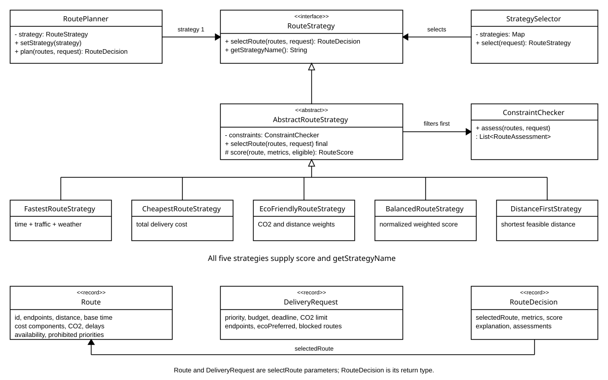
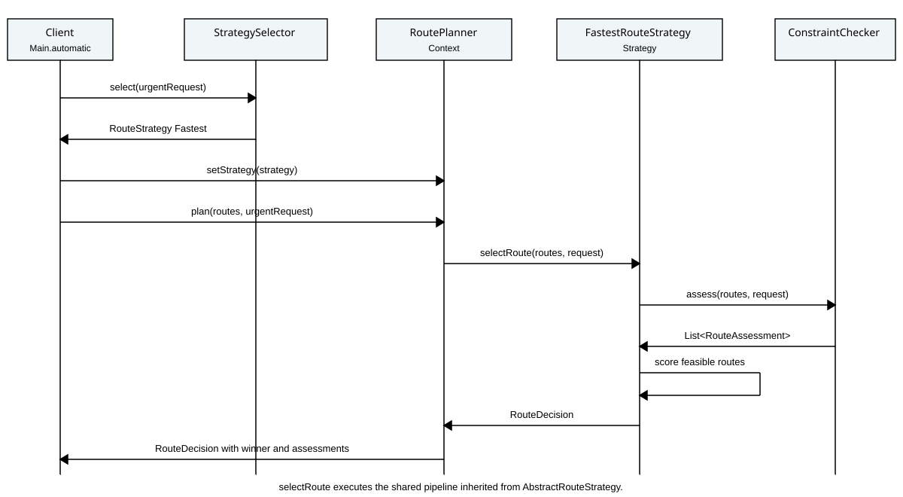

# Smart Delivery and Route Optimization Engine

Assignment 5 implements the **Strategy Pattern** in Java 17. Five interchangeable
algorithms select a route from eight candidates, after applying the same delivery
constraints. Every successful decision includes a score, a formula explanation,
and assessments for all candidates. There are no runtime application dependencies.

## Run and test

Install a **JDK 17 or later** and make `java`, `javac`, and `jar` available.
Windows PowerShell, from this project directory:

```powershell
powershell -ExecutionPolicy Bypass -File .uild.ps1 -Run
```

Linux or macOS, with curl and a JDK:

```sh
sh build.sh --run
```

These scripts compile with `--release 17`, download a pinned JUnit Console JAR
from Maven Central, verify its SHA-256, execute the tests, and create an executable
`target/smart-delivery.jar`. The first test build needs internet; the dependency
is cached in `.deps`. On Windows, `-SkipTests` builds the application offline.

Maven is also supported and was independently verified:

```sh
mvn test
mvn package
java -jar target/smart-delivery.jar
```

The supplied download package also contains `dist/smart-delivery.jar`, which
runs directly with a Java 17+ runtime:

```sh
java -jar dist/smart-delivery.jar
```

The optional modes are `--compare`, `--switch`, `--auto`, `--failures`, and `--help`.
With no arguments all four demonstrations run. An unknown argument exits with code 2.

## Architecture and pattern

**Problem solved.** Different requests need different route ranking algorithms.
Strategy encapsulates these algorithms behind a shared contract and lets the
client replace the algorithm without modifying route planning.

**Context.** `RoutePlanner` stores a `RouteStrategy`, exposes `setStrategy`, and
delegates `plan` to it. It contains no scoring algorithm, strategy-name switch,
or checks for concrete strategy types.

**Strategy abstraction.** `RouteStrategy.selectRoute(routes, request)` returns
a `RouteDecision`. Returning a decision instead of only a route is an intentional
improvement over the assignment's minimal interface: explanations, score, metrics,
and rejection reasons travel together in one immutable result.

**Concrete strategies.** FastestRouteStrategy, CheapestRouteStrategy,
EcoFriendlyRouteStrategy, BalancedRouteStrategy, and DistanceFirstStrategy.
`AbstractRouteStrategy` shares feasibility checking and deterministic ranking;
each concrete class supplies its own scoring formula.

**Selection policy.** `StrategySelector` receives a priority-to-strategy map.
URGENT selects Fastest even when ecoPreferred is true. Otherwise an eco preference
selects Eco; remaining requests use their configured priority mapping: ECONOMY
to Cheapest, ECO to Eco, STANDARD to Balanced. The selector chooses an algorithm;
that algorithm chooses a route. Map values can be replaced without changing the
selector. Adding a new business category would also require extending the enum
and configuring its mapping.

**Why this is Strategy.** The same Context delegates the same operation to
interchangeable objects. A few conditions in business-policy selection or CLI
argument handling do not implement route algorithms. There is no growing
if/else chain of routing algorithms inside the Context.

## Domain and hard constraints

Immutable records represent `Location`, `Route`, `DeliveryRequest`, `RouteMetrics`,
`RouteAssessment`, and `RouteDecision`. Routes include endpoints, distance, base
travel time, traffic and weather delays, cost components, emissions, availability,
and prohibited delivery priorities. Requests include budget, deadline, emission
limit, eco preference, and individually blocked route IDs. Collections are copied.

`ConstraintChecker` records **every** applicable rejection reason before scoring:
unavailable route, endpoint mismatch, budget exceeded, deadline exceeded, emission
limit exceeded, blocked route ID, or prohibited priority. All five strategies use
this shared checker. Equality with a budget, deadline, or emission limit is valid.
Costs include the request's surcharge; deadlines include traffic and weather.
Rejected candidates never receive a score and cannot win.

Empty input and a fully infeasible candidate set throw `NoSuitableRouteException`.
Its assessments preserve rejection reasons. Null required values throw a
descriptive `NullPointerException`. Invalid numeric data, duplicate route IDs,
invalid coordinates, time overflow, and invalid configurations fail explicitly.

## Scoring formulas

Lower scores always win. Exact score ties use ascending route ID, independently
of input order. Scores have different units across strategies and must not be
directly compared with each other.

| Strategy | Formula or rule |
| --- | --- |
| Fastest | `effectiveMinutes = estimatedMinutes + trafficDelayMinutes + weatherDelayMinutes` |
| Cheapest | `totalCost = baseCost + distanceKm * costPerKm + prioritySurcharge + additionalFees` |
| Eco Friendly | `emissionKg * emissionWeight + distanceKm * distanceWeight`, defaults 1.0 and 0.05 |
| Balanced | `normalizedTime * wt + normalizedCost * wc + normalizedDistance * wd + normalizedEmission * we` |
| Distance First | Minimum distance among feasible routes |

Monetary calculations use `BigDecimal` and round the final sum once to two decimal
places with HALF_UP, then expose the amount as a double in the assignment's domain.
Currency is KZT. The fixed priority surcharge is URGENT 500, STANDARD 150, ECONOMY
0, and ECO 0. These are demonstration business assumptions, not market prices.

Balanced uses min-max normalization **only across feasible candidates**:

```text
normalized(x) = (x - minimum) / (maximum - minimum)
normalized(x) = 0 when maximum == minimum
default weights = (time 0.40, cost 0.30, distance 0.10, emission 0.20)
```

`OptimizationWeights` rejects non-finite, negative, or greater-than-one weights
and sums differing from 1.0 by more than 1e-9. Zero weights are permitted.
Normalization prevents a price in thousands from overwhelming time or emissions.
Eco weights are non-negative and at least one must be positive. They express
environmental policy and belong inside EcoFriendlyRouteStrategy, rather than in
the Context or the domain records.

## Demonstration results

Request 105 is STANDARD, budget 10000 KZT, deadline 120 minutes, emission limit
20 kg. All candidates have the same origin and destination. Demo data are fictional.

| Route | Effective min | Total KZT | Distance km | CO2 kg | Availability |
| --- | ---: | ---: | ---: | ---: | --- |
| R01 | 40 | 3850 | 12 | 4.50 | Available |
| R02 | 25 | 6220 | 17 | 6.50 | Available |
| R03 | 50 | 1950 | 20 | 3.80 | Available |
| R04 | 38 | 3050 | 15 | 0.80 | Available |
| R05 | 58 | 850 | 10 | 0.10 | Available except URGENT |
| R06 | 32 | 2975 | 13 | 2.00 | Available |
| R07 | 47 | 3210 | 8 | 3.00 | Available |
| R08 | 10 | 300 | 5 | 0.05 | Unavailable |

```text
Fastest -> R02 | 25 min | 6220.00 KZT | score 25.0000
Cheapest -> R05 | 58 min | 850.00 KZT | score 850.0000
Eco Friendly -> R05 | 58 min | 850.00 KZT | score 0.6000
Balanced -> R06 | 32 min | 2975.00 KZT | score 0.3046
Distance First -> R07 | 47 min | 3210.00 KZT | score 8.0000
```

Example Balanced calculation for R06:
`0.2121*0.40 + 0.3957*0.30 + 0.4167*0.10 + 0.2969*0.20 = 0.3046`.
R08 is excluded before computing these ranges.

**Runtime switching** is in `Main.switching`: one planner initially uses Fastest,
then switches three times to Cheapest, Eco, and Balanced. The same Fastest strategy
chooses R02 for budget 10000 but R03 for budget 2500, proving request-sensitive
behavior. `Main.automatic` demonstrates the selector. `StrategyComparison` runs
all registered strategies on identical inputs and represents no-route failures
explicitly for each strategy. The full, actual output is in
[docs/console-output.txt](docs/console-output.txt).

## UML diagrams

[Class diagram](docs/uml/class-diagram.svg)
and [sequence diagram](docs/uml/sequence-diagram.svg) are also included in the
[PDF report](docs/Report.pdf). Editable Mermaid sources are beside the SVGs.





The sequence follows `Main.automatic` for an urgent request. The concrete Fastest
object inherits `selectRoute` from AbstractRouteStrategy and supplies its score.
The planner returns the resulting RouteDecision to the client.

## Tests

**51 JUnit 5 tests passed; 0 failures, 0 errors, 0 skipped.** Both the standalone
build and `mvn test package` were executed with OpenJDK 25.0.4, targeting Java 17.
Compilation uses Java 17 API checking and class format 61. Tests were not run
on an actual JDK 17 installation in this session. The shell script is provided
for Linux/macOS; the tested script on this Windows machine is build.ps1.

| Test class | Tests | Main coverage |
| --- | ---: | --- |
| StrategyTest | 17 | Four original algorithms, formulas, normalization, ties, dynamic requests, explanations |
| ConstraintsTest | 17 | Availability, budget, deadline, emissions, prohibited/blocked routes, boundaries, failures |
| ArchitectureTest | 12 | Three runtime switches, delegation, all selection rules, reconfiguration, comparison |
| DistanceFirstStrategyTest | 5 | Fifth algorithm, hard constraints, Context substitution, ties, comparison registration |

[Test results](docs/test-results.txt) are copied from the actual Maven reports.
Re-running Maven creates XML reports under `target/surefire-reports`; the standalone
runner writes XML under `target/test-reports`.

## Extension and SOLID

`DistanceFirstStrategy` was introduced in separate commit `9baf7b3`, after the
four-strategy application and 45 tests worked. A later surcharge explanation
regression test brought the original-strategy suite to 46 tests; the fifth
strategy added five more. Its introduction added one production class and one
test class, and changed **only one existing production class**, DemoData, to
register it for comparison. Neither RoutePlanner nor StrategySelector changed.

To add another strategy, extend AbstractRouteStrategy, implement `score` and
`getStrategyName`, add focused tests, and register the instance in the composition
root. To use it automatically for an existing priority, replace that priority's
map value. Implementing RouteStrategy directly is also possible, but that class
is then responsible for preserving the same constraint and explanation contract.

- **SRP:** RoutePlanner delegates, each strategy ranks routes, ConstraintChecker
  evaluates feasibility, StrategySelector implements selection policy, and Main
  handles console presentation.
- **OCP:** a new ranking algorithm is an additional class and registration change.
  Existing planning and selection code does not need algorithm-specific branches.
- **DIP:** RoutePlanner's field, constructor, and setter use the RouteStrategy
  abstraction. Concrete classes are wired in DemoData.

**Strategy versus Bridge.** Strategy replaces an algorithm for the same task.
Bridge separates an abstraction hierarchy from an implementation hierarchy so
both can vary independently, for example delivery services and notification
channels. This project varies the route-selection algorithm. This comparison
describes the patterns; it does not assume the contents of an earlier assignment.

## Limitations

This engine selects one supplied candidate for one request. It does not generate
paths from a road graph, schedule a vehicle fleet, or solve the vehicle routing
problem. Traffic, weather, fees, and emissions are static estimates. Balanced
recomputes min/max ranges for each candidate, so its current implementation is
O(n^2); caching the four ranges once per request would make it O(n). Its min-max
scores depend on the feasible candidate set and can change when a feasible route
is added. Other strategies are O(n). A mutable RoutePlanner is intended for a
single-threaded client; use a planner per concurrent request. Location matching
uses exact record equality, rather than a geographic tolerance or persistent ID.

## Repository history and submission

The local project has a sequence of meaningful commits made during this work.
The fifth strategy has its own commit. Dates have not been backdated. For the
downloadable ZIP, history is additionally preserved in
`history/smart-delivery.bundle`. Restore it from the extracted project directory:

```sh
git clone history/smart-delivery.bundle ../smart-delivery-with-history
```

Publish the repository as public under the intended GitHub account, and submit
its URL together with README or docs/Report.pdf in Moodle. The PDF is in English;
[docs/DEFENSE_RU.md](docs/DEFENSE_RU.md) contains a Russian defense guide.

## References

- [JUnit 5.11.4 User Guide](https://docs.junit.org/5.11.4/user-guide/index.html)
- [Apache Maven Compiler Plugin](https://maven.apache.org/plugins/maven-compiler-plugin/)
- [Apache Maven Surefire](https://maven.apache.org/surefire/surefire/)
